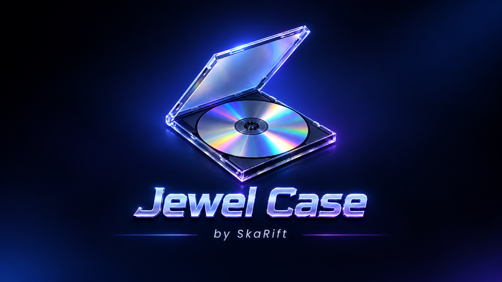
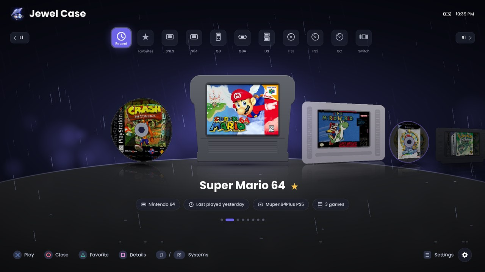
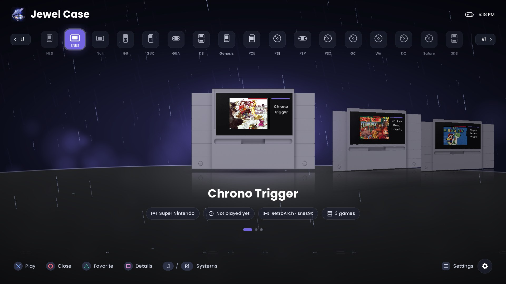
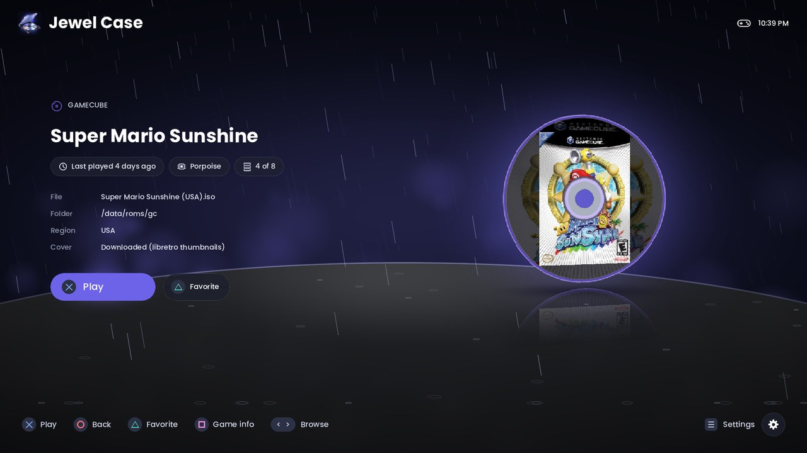
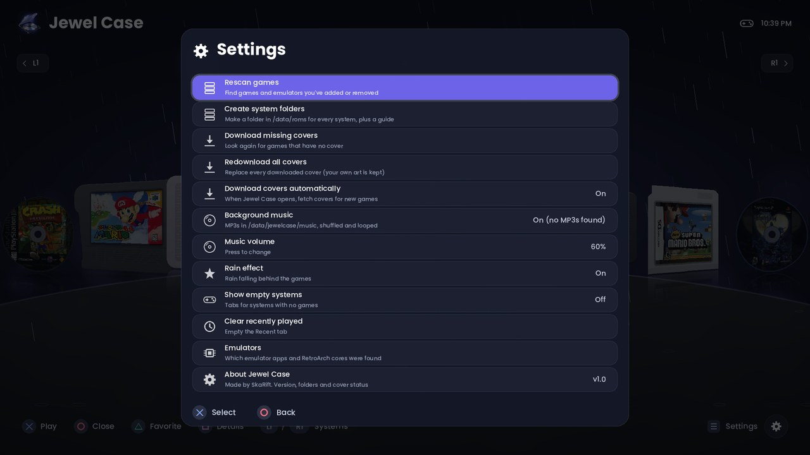

<p align="center">
  
</p>

<p align="center">
  A home-screen ROM launcher for jailbroken PS5 consoles.<br>
  Every system's games on one shelf, as cartridges and discs with box art, each started in the right emulator.
</p>

<p align="center">
  <a href="../../releases/latest"><b>Download the latest release</b></a>
</p>

---



| | |
|---|---|
|  |  |
|  | |

## Features

- **One launcher for everything.** NES to Xbox 360, sorted into tabs by system, with
  **Recently Played** and **Favorites** tabs.
- **Real-looking media.** Every game is drawn as its system's cartridge, card or disc, with
  its cover printed on it, in a carousel with reflections on a glossy floor.
- **Automatic box art.** Covers download from the
  [libretro thumbnail collection](https://github.com/libretro-thumbnails) and are matched by
  file name, ignoring region tags and punctuation. Your own art always takes priority.
- **Standalone emulators first.** Jewel Case starts each game in a dedicated PS5 emulator
  app when you have one installed, and falls back to RetroArch with a matching core.
- **Details screen** for each game: its emulator, when you last played it, the file, its
  region and size, and where the cover came from.
- **Background music** (your own MP3s, shuffled) and a rain effect, both optional.
- **Native app.** It has its own home-screen icon, installs with ShadowMountPlus, and needs no
  browser or Homebrew Launcher.

## Requirements

- A jailbroken PS5 running **etaHEN**. Jewel Case sends small helper payloads to its ELF
  loader on port 9021. Tested on firmware 13.42.
- **ShadowMountPlus**, or another way to install a homebrew app folder.
- One or more emulators:

| System | Emulator used (first one found) |
|---|---|
| PlayStation | PSXS5, then RetroArch (SwanStation, PCSX ReARMed, Beetle PSX) |
| PlayStation 2 | PS5SX2, then RetroArch (LRPS2) |
| Nintendo 64 | Mupen64Plus PS5, then RetroArch (Mupen64Plus-Next, ParaLLEl) |
| GameCube / Wii | Porpoise, then RetroArch (Dolphin) |
| DS / 3DS | PS5CEMU-HAR, then RetroArch (melonDS, DeSmuME, Azahar) |
| Wii U | PS5CEMU-HAR |
| Dreamcast | PSFlycast, then RetroArch (Flycast) |
| Switch | ProsperoEden |
| Xbox / Xbox 360 | XPSemu / PS5X360 |
| Everything else | RetroArch (PPSA99169) with the matching core |

## Install

1. Download `PPSA75837.zip` from [Releases](../../releases).
2. Extract it and copy the `PPSA75837` folder to `/data/homebrew/` on your PS5.
3. Install it with ShadowMountPlus, then start **Jewel Case** from the home screen.

To update, overwrite the files in the same folder.

## Adding games

Put each system's games in its own folder under `/data/roms` (or `/mnt/usb0/roms` on a USB
drive):

```
/data/roms/snes/Super Mario World (USA).sfc
/data/roms/psx/Final Fantasy VII (USA).m3u
/data/roms/ps2/Kingdom Hearts (USA).iso
```

**Settings → Create system folders** makes every folder for you. It also writes a guide in
`/data/roms` listing each folder and the file types it takes. After adding games, use
**Settings → Rescan games**.

No-Intro / Redump style file names, such as `Super Mario World (USA).sfc`, match covers
best. To use your own art, put a `.png` or `.jpg` named like the game next to its file, or
in a `covers` folder there.

Music: put MP3 files in `/data/jewelcase/music`. Jewel Case creates this folder on first
run.

## Controls

| Carousel | | Details screen | |
|---|---|---|---|
| Left / Right | choose a game | Left / Right | previous / next game |
| L1 / R1 | change system | Cross | play |
| L2 / R2 | jump 10 games | Triangle | favorite |
| Cross | play | Square | technical info |
| Triangle | favorite | Circle | back |
| Square | details screen | | |
| Options | settings | | |
| Circle | close Jewel Case | | |

## Building from source

See [BUILDING.md](BUILDING.md). In short, on Linux or WSL:

```sh
make          # builds the helpers and the app into dist/PPSA75837
make host     # PC test build, needs SDL2 (build-host/jewelcase --fsroot <folder>)
```

## Known limitations

- PSXS5 and PS5SX2 don't accept a game at launch yet, so they open their own game list.
- Cover matching works from file names, so heavily renamed files may get no cover. Add your
  own art for those.

## Credits

Jewel Case by **SkaRift**.

Built on [ps5-native-app-boilerplate](https://github.com/blackbearreloaded/ps5-native-app-boilerplate) (BlackBearReloaded)
and the [PS5 payload SDK](https://github.com/ps5-payload-dev/sdk), with SDL2, cJSON, stb,
dr_mp3 and the Poppins font. The cartridges, cards and discs are rendered from CC BY 4.0 models by
Steven-Bennis, HippoStance, Karolina D, Vxcl, Pcwer, crocoman2019 and enjoyboy
([credits](assets/media/CREDITS.md)). Box art comes from
[libretro-thumbnails](https://github.com/libretro-thumbnails). Thanks to the etaHEN and
ShadowMountPlus developers and to the authors of every emulator listed above. See
[THIRD_PARTY_NOTICES.md](THIRD_PARTY_NOTICES.md).

Jewel Case includes no games, BIOS files or covers. Use backups you made yourself.

## License

[GNU GPL v3](LICENSE).
